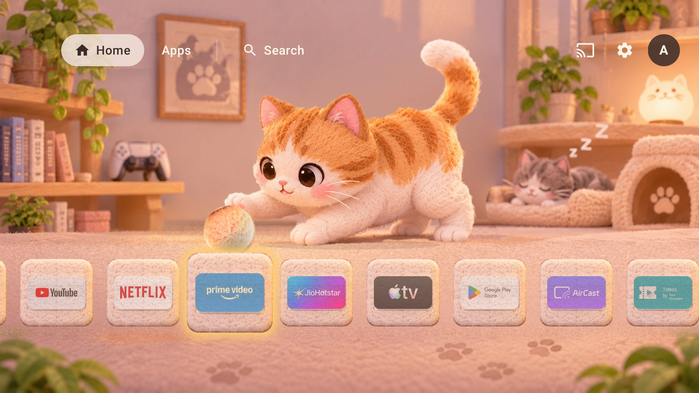
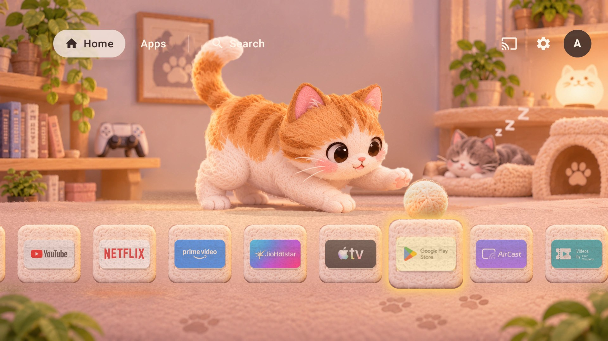

# Cozy Cat Launcher 🐱🧶

A cozy, animated home screen for Android TV and Google TV. A knitted orange kitten sits in a warm
little room and plays with a ball of yarn while you pick what to watch. A grey kitten naps by the cat
house.



## What it does

- **The kitten plays along.** As you move through your apps, the yarn ball rolls to the selected app.
  The kitten turns to face it with a little hop, its eyes follow the ball, and it pounces.
- **It never goes off screen.** The ball moves across the four middle app slots. Keep pressing and
  the whole knitted app row slides past instead, looping around your apps.
- **It feels alive.** The kitten breathes, blinks, flicks its ears and swishes its tail. When you
  leave the remote alone, it wiggles and pats the ball by itself.
- **It works with every app.** Each installed app gets a knitted tile with its own banner stitched on.
  OK opens the app, with a little paw tap first.
- **It's smooth on cheap TVs.** All the art is pre-rendered at your screen's size, so it runs at a
  steady 50-60 fps even on low-end TV chips.
- **It's a real home screen.** It has Search (Google Assistant), Cast, Settings and an **Apps** page
  with everything installed, including any other launchers, so you can switch between them.
- **It's safe to try.** It doesn't remove, disable or change anything on your TV. Uninstall it and
  your TV is exactly as it was.



**You need:** an Android TV or Google TV running Android 9 or newer, a computer (Windows, macOS or
Linux), and a USB cable or a TV that supports network debugging.

---

## Install it in 3 steps

### 1. Turn on USB debugging on the TV

1. On the TV, open **Settings → Device Preferences → About** (on Google TV: **Settings → System →
   About**).
2. Scroll to **Build** and press **OK** on it **7 times**, until it says "You are now a developer".
3. Go back and open **Developer options**, which now appears under Device Preferences or System.
4. Turn on **USB debugging**. If you see **Network debugging** or **Wireless debugging**, you can
   turn that on too to connect over Wi-Fi instead of a cable.

### 2. Connect the TV to your computer

- **With a cable:** most TVs need a **USB-A to USB-A** cable, because a phone cable won't work.
  Plug it into the TV's USB port and your computer.
- **Over Wi-Fi (if your TV has Network debugging):** note the IP address shown there. You'll connect
  with `adb connect <tv-ip>:5555`.

When the TV shows **"Allow USB debugging?"**, tick **Always allow from this computer** and press
**OK**.

### 3. Install, the easy way: ask Claude

Open [Claude Code](https://claude.com/claude-code) on your computer and say:

> Install the Cozy Cat Launcher from https://github.com/AbshkPskr/cozy-cat-launcher on my TV.
> USB debugging is on and the TV is connected.

Claude reads this repo's [`CLAUDE.md`](CLAUDE.md), which has step-by-step instructions written for it.
It checks the connection, installs the launcher, and asks you before making it your home screen.

### 3. Install, or do it yourself with one command

**Windows** (PowerShell):

```powershell
irm https://raw.githubusercontent.com/AbshkPskr/cozy-cat-launcher/main/install.ps1 | iex
```

**macOS / Linux** (Terminal):

```bash
curl -fsSL https://raw.githubusercontent.com/AbshkPskr/cozy-cat-launcher/main/install.sh | bash
```

The script:
1. Downloads Google's `adb` tool if you don't have it.
2. Finds your TV and checks it's Android 9 or newer.
3. Downloads the latest release and installs it.
4. Opens the launcher.

It changes nothing else on the TV.

You can also grab `CozyCatLauncher.apk` from the
[Releases page](https://github.com/AbshkPskr/cozy-cat-launcher/releases/latest) and run
`adb install CozyCatLauncher.apk` yourself.

---

## Make it your home screen

Either:

- **With the remote:** press **Home** on the remote. If the TV asks which app to use, pick
  **Cozy Cat Launcher → Always**.
- **With the script:** run it with `-SetHome` (Windows) or `--set-home` (macOS/Linux) to set it from
  the computer.

```powershell
.\install.ps1 -SetHome
```

Some TVs ignore both and always open their own home screen. Cozy Cat still works there: open it
from the TV's Apps list.

## Switch back or remove it

```powershell
.\install.ps1 -Restore          # Windows: give Home back to the TV's own launcher
```
```bash
./install.sh --restore           # macOS / Linux
adb uninstall com.cozycat.launcher   # remove it completely
```

Cozy Cat never disables or uninstalls anything, so after `adb uninstall` the TV is exactly as it was.

## Remote controls

| Button | What happens |
| --- | --- |
| ◀ ▶ | Ball rolls to the next app, and the kitten turns and pounces |
| OK | Kitten taps, ball bounces, app opens |
| ▲ / ▼ | Top bar (Home, Apps, Search, Cast, Settings, account) and back |
| Home | Back to the kitten, with the last app you opened selected |
| Back | Back to the Home tab |

---

## Build it yourself

You need JDK 17 and the Android SDK, which Android Studio includes.

```bash
git clone https://github.com/AbshkPskr/cozy-cat-launcher.git
cd cozy-cat-launcher
./gradlew assembleRelease        # Windows: gradlew.bat assembleRelease
./install.sh                     # installs the build it just made (Windows: .\install.ps1)
```

Without a signing key, release builds are signed with your local debug key. That's fine for your own
TV. To install over the official release, uninstall it first, since the signatures differ.

### Change the look

All the art comes from one picture, [`art/mockup.png`](art/mockup.png). Two scripts cut it into the
room, the kitten parts (body, tail, ears, legs, eyes), the sleeping kitten, the ball and the knitted
tile. See [`art/README.md`](art/README.md).

Tunable settings live in
[`LauncherConfig.kt`](app/src/main/java/com/cozycat/launcher/LauncherConfig.kt): pinned apps, hidden
apps, timings and more.

| File | What it does |
| --- | --- |
| `LauncherScreen.kt` | Puts the scene together, handles focus, Home and Back |
| `Carousel.kt` | The sliding app row (8 slots, selection stays in the middle 4) |
| `KittenScene.kt` | Kitten and ball animation: turn, pounce, breathing, eyes following the ball |
| `SceneAssets.kt` | Where each art piece sits on screen |
| `AppRepository.kt` | Lists installed apps and stitches their banners onto knitted tiles |
| `TopBar.kt`, `Components.kt` | Top navigation and app tiles |

## Troubleshooting

- **"No TV found":** check the cable (it must be USB-A to USB-A for most TVs) and that USB debugging
  is on. Run `adb devices` and you should see one line ending in `device`.
- **"unauthorized":** look at the TV and accept the **Allow USB debugging** prompt.
- **Choppy animation right after install:** the installer pre-compiles the app for speed. If you
  installed with plain `adb install`, run `adb shell cmd package compile -m speed -f com.cozycat.launcher`.
- **Home still opens the old screen:** see [Make it your home screen](#make-it-your-home-screen).

## License

Code and art are [MIT licensed](LICENSE). App names and banners shown on the tiles belong to their
owners. The launcher only displays each installed app's own banner.
